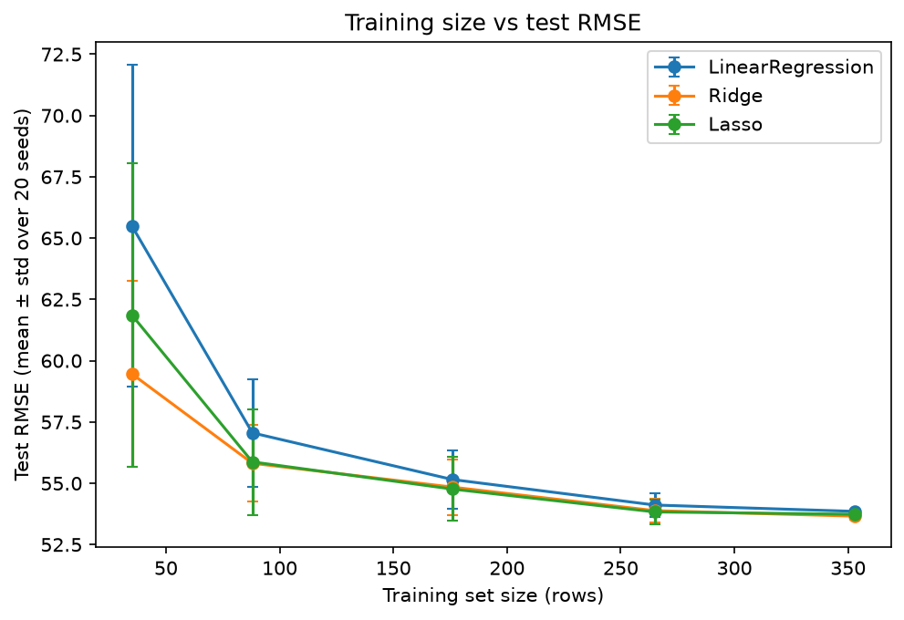
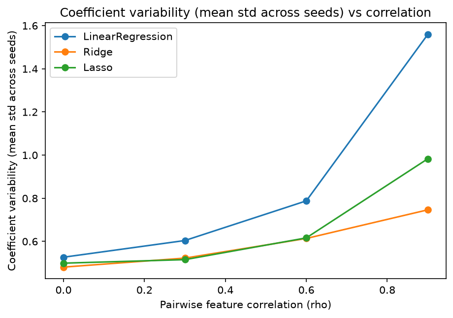
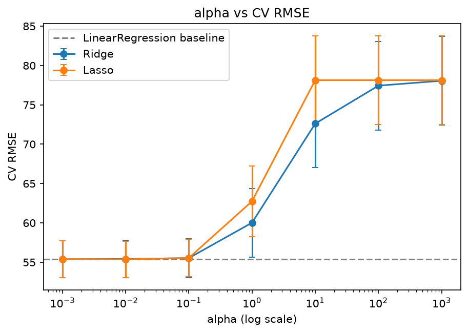
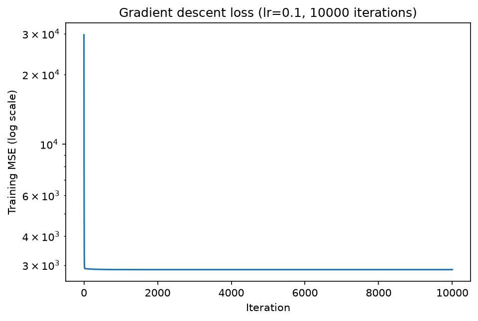

# Regularization, Training-Set Size and Feature Correlation in Linear Regression

An experimental study of when Ridge and Lasso help ordinary least squares (OLS), and when they don't.
The study uses the scikit-learn Diabetes dataset plus controlled synthetic data, and includes a
from-scratch NumPy implementation of gradient descent for linear regression.

**Full write-up:** [`report/research_report.pdf`](report/research_report.pdf)

## Research questions

| | Question |
|---|---|
| **RQ1** | How does regularization strength affect the generalization of linear regression? |
| **RQ2** | Does regularization help more when training data is limited? |
| **RQ3** | How does feature correlation affect coefficient stability, and can regularization reduce the instability? |

## Key findings

All numbers below come from the saved experiment outputs in `results/` and are discussed with their
limitations in the report. They describe the conditions tested, not Ridge or Lasso in general.

- **RQ1 – regularization strength (Diabetes, 353 training rows).** For alpha ≤ 0.1, Ridge and Lasso
  matched OLS in 5-fold CV (CV RMSE 55.36–55.54 vs 55.39 for OLS; fold-to-fold std ≈ 2.4). From
  alpha = 1 upward, error increased, and Lasso with alpha ≥ 10 predicted the mean (R² ≈ 0). Test RMSE
  at alpha = 0.1 was lower (Lasso 52.90, Ridge 53.45, OLS 53.85), but CV did not confirm it and the
  test set has only 89 rows, so it is not treated as an effect.
- **RQ2 – training-set size (20 seeds).** Regularization helped most with little data. With 35 training
  rows, mean test RMSE was 65.50 (OLS), 59.46 (Ridge) and 61.86 (Lasso). From 176 rows the gain
  shrank to about 0.1–0.4 RMSE points.
- **RQ3 – feature correlation (synthetic, 50 seeds per level).** Raising pairwise correlation from 0 to
  0.9 made OLS coefficients about 3× more variable (0.527 → 1.559) and about 3× further from the truth
  (1.64 → 4.83) while its prediction error stayed the same (RMSE 5.312). At correlation 0.9, Ridge
  reduced variability to 0.746 and Lasso to 0.983, at the cost of shrinkage bias; neither recovered
  the true sparse structure.
- **Gradient descent from scratch.** With learning rate 0.1 and 10,000 iterations it reached the same
  solution as scikit-learn `LinearRegression` on the same standardized data (training MSE 2868.5497,
  test RMSE 53.8534 for both). A learning rate of 0.3 diverged.

| Hypothesis | Verdict |
|---|---|
| H1 – moderate regularization improves generalization under higher-variance conditions | Partially supported |
| H2 – the benefit is larger when training data is limited | Supported |
| H3 – correlation destabilizes OLS coefficients and Ridge reduces the instability | Supported in this synthetic setting, with qualifications |

<p align="center">
  
  
</p>
<p align="center">
  
  
</p>

## Repository structure

```
.
├── notebooks/
│   ├── 01_baseline.ipynb             # EDA, OLS baseline, Exp. 1 (alpha sweep), Exp. 2 (training size)
│   ├── 02_feature_correlation.ipynb  # Exp. 3: controlled synthetic feature-correlation study
│   └── 03_gradient_descent.ipynb     # gradient descent from scratch vs scikit-learn
├── src/                              # reusable code imported by the notebooks
│   ├── data.py                       # Diabetes split, synthetic data generator
│   ├── models.py                     # alpha sweep, training-size experiment
│   ├── metrics.py                    # MSE / RMSE / R²
│   ├── gradient_descent.py           # from-scratch linear regression
│   └── experiment_log.py             # writes the structured experiment records
├── results/
│   ├── figures/                      # all saved plots
│   ├── tables/                       # CSV results (raw runs and summaries)
│   └── experiments/                  # one .json + .md record per experiment (settings, seeds, protocol)
├── report/                           # research report (PDF)
├── data/                             # intentionally empty, see data/README.md
├── scripts/                          # maintenance helpers
├── requirements.txt
└── README.md
```

The experiment record files in `results/experiments/` use their own numbering:
`exp1_baseline`, `exp2_regularization_sweep`, `exp3_training_size`, `exp4_feature_correlation`,
`exp5_gradient_descent`. In the report these correspond to the baseline, Experiment 1 (alpha sweep),
Experiment 2 (training size), Experiment 3 (feature correlation) and the gradient-descent study.

## Methodology in brief

| Study | Data | Protocol |
|---|---|---|
| Alpha sweep | Diabetes, 442 rows, 10 features; fixed 80/20 split (`random_state=42`) | alpha ∈ {0.001 … 1000}; same 5-fold shuffled CV and same test set for every model |
| Training size | Same split; training portion subsampled to 10/25/50/75/100 % (35–353 rows) | 20 seeds; alpha chosen by 5-fold CV on each subset only; test set never used for tuning |
| Feature correlation | Synthetic: 10 features, equal pairwise correlation ρ ∈ {0, 0.3, 0.6, 0.9}, 5 informative + 5 noise features, σ = 5 | 100 training rows, 2,000 fresh test rows, 50 seeds per ρ (same seeds across ρ); alpha by 5-fold CV |
| Gradient descent | Diabetes, features standardized with training statistics | Learning rate 0.1, 10,000 iterations; analytic gradients checked against finite differences |

## How to reproduce

```bash
git clone <this-repo-url>
cd <repo-folder>

python -m venv .venv
# Windows:   .venv\Scripts\activate
# macOS/Linux: source .venv/bin/activate

pip install -r requirements.txt
jupyter lab
```

Run the notebooks in order (**Kernel → Restart & Run All**): `01_baseline`, `02_feature_correlation`,
`03_gradient_descent`. Each notebook writes its figures to `results/figures/` and its tables to
`results/tables/`. The full set of experiments runs in a few minutes on a laptop.

The Diabetes data ships with scikit-learn, so nothing needs to be downloaded. All random seeds are
fixed and recorded in `results/experiments/`.

Developed with Python 3.14.2, scikit-learn 1.9.1, NumPy 2.5.3 and pandas 3.0.6. Other versions should
work, but small numerical differences are possible.

## Limitations

One small, pre-processed real dataset; a single fixed 80/20 split with an 89-row test set; a coarse
power-of-ten alpha grid; one synthetic configuration with equal pairwise correlation; and no formal
significance tests. Several explanations in the report are plausible mechanisms that were not tested
directly. See Section 9 of the report.

## Author

Anubhav Gautam, B.Tech Computer Science and Engineering, Delhi Technological University.
